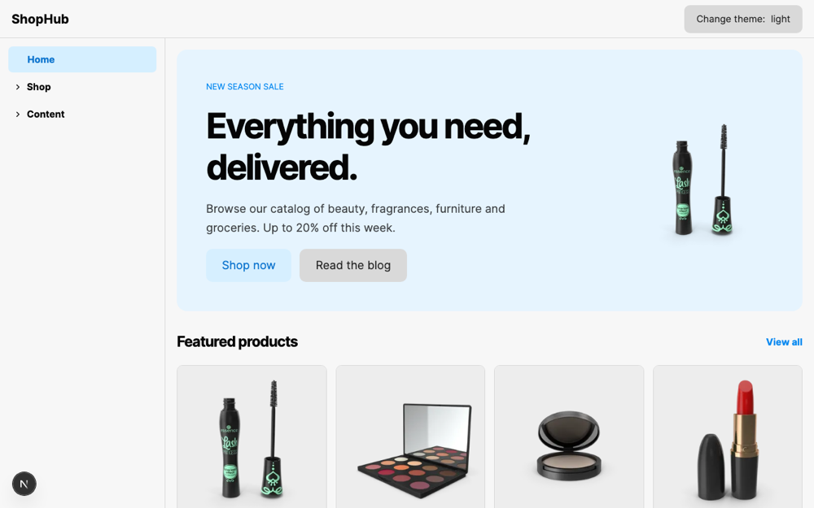
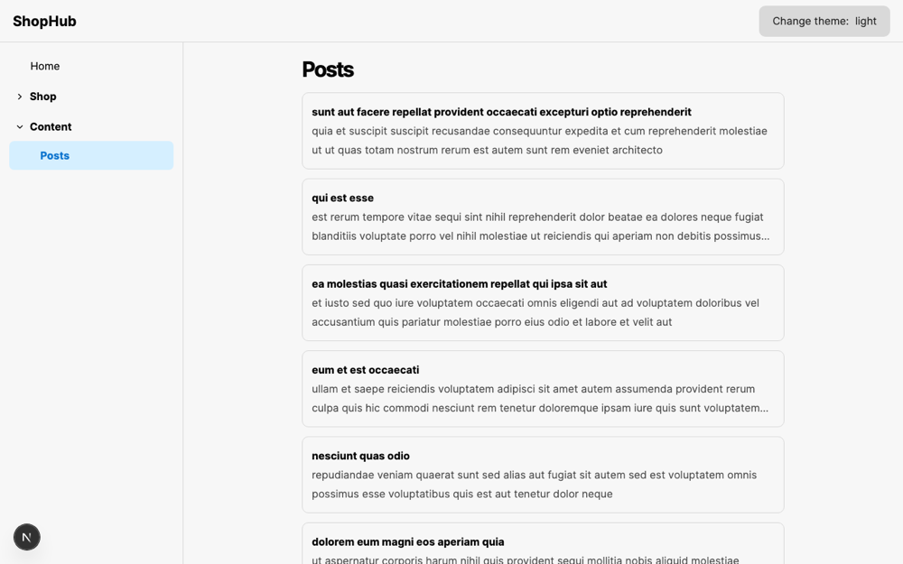
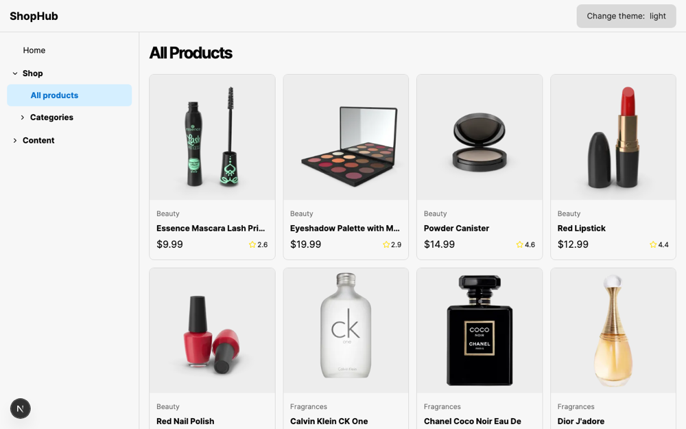
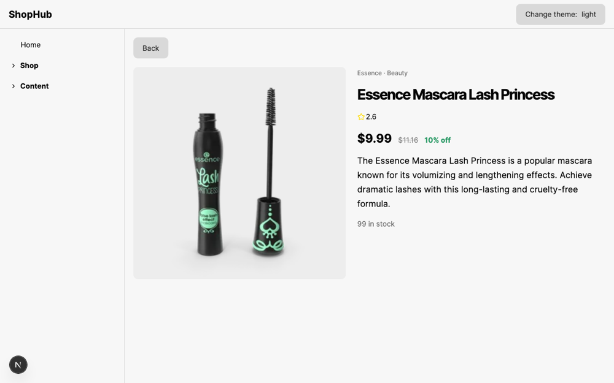
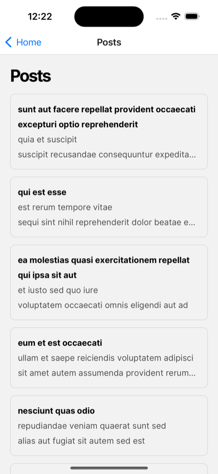
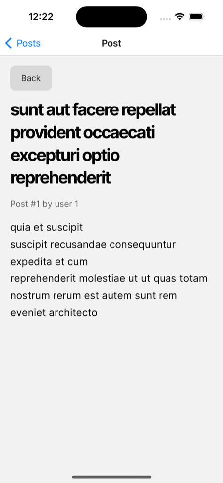
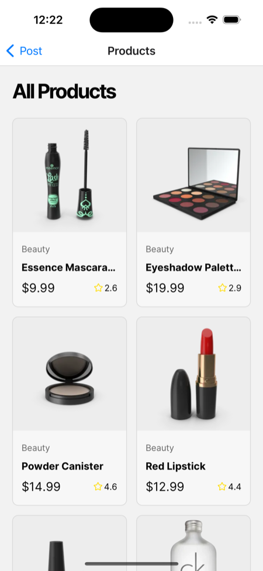
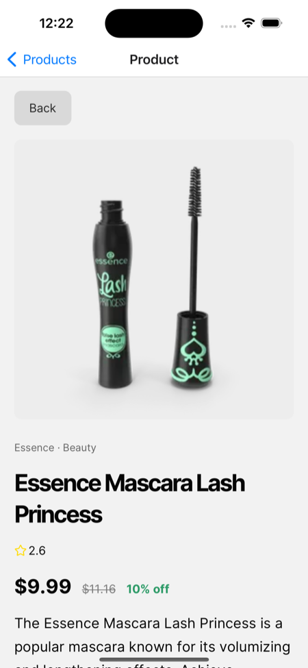

# Posts App (ShopHub)

One shared UI and feature codebase, rendered as a **Next.js web app** and an **Expo (iOS / Android) native app**. It shows posts from [JSONPlaceholder](https://jsonplaceholder.typicode.com) and a product catalog from [DummyJSON](https://dummyjson.com).

Built on the Tamagui + Solito + Next + Expo monorepo starter (`npm create tamagui`, the "Next + Expo" template). Thanks to [@FernandoTheRojo](https://twitter.com/fernandotherojo) for the Solito starter it was forked from.

## Screenshots

### Web (Next.js, 1280×800)

| Home | Posts |
| --- | --- |
|  |  |
| **Products** | **Product detail** |
|  |  |

### iOS (Expo, iPhone 15 Pro simulator)

| Posts | Post detail | Products | Product detail |
| --- | --- | --- | --- |
|  |  |  |  |

The same screen components render on both platforms. Web adds a sidebar shell (`features/shell`), and native uses stack navigation.

## Tech stack

| Layer | Choice | Version |
| --- | --- | --- |
| Web framework | Next.js (App Router, Turbopack in dev, webpack for production) | 16.1.1 |
| Native framework | Expo SDK + Expo Router | 54 / 6.0 |
| UI / styling | Tamagui (`@tamagui/config/v5`) | 2.0.0-rc.16 |
| Cross-platform navigation | Solito (yarn-patched) | 5.0.0 |
| Runtime | React / React Native / react-native-web | 19.1.0 / 0.81.5 / 0.21.2 |
| Language and tooling | TypeScript, Biome, Vitest, Playwright, Husky | 5.9 / 1.9 / 2.1 |
| Monorepo | Yarn 4 workspaces (`node-modules` linker), Node 22 | 4.5.0 |

### How the pieces fit

- **`packages/app`** holds the shared features (`features/<feature>/`) and providers. Both apps import it as `app/...`.
- **Routing is per platform**: Next App Router in `apps/next/app`, Expo Router in `apps/expo/app`. Solito's `Link` and navigation hooks let shared screens navigate on both. The two route trees are kept in sync by hand.
- **Data fetching differs per platform**: web routes are async Server Components that fetch on the server, and native wraps the same presentational screens with client-side fetching.
- **`packages/ui` (`@my/ui`)** is the component kit and **`packages/config` (`@my/config`)** is the Tamagui config. Both build to `dist/`.

## Pros and cons of this stack

### Pros

- **One UI codebase for web and native.** Screens, theming, and components are written once, and the route files are thin wrappers.
- **Real SSR and SEO on web.** Next.js Server Components, `notFound()`, metadata, and Vercel deployment are first-class. Expo Router web has weaker server rendering and rendering control.
- **Native-quality navigation.** Expo Router gives real native stack navigation on iOS and Android, with deep links working out of the box.
- **Optimizing styling layer.** Tamagui's compiler can extract styles to atomic CSS on web (`yarn web:prod`), with a typed token, theme, and animation system and automatic light/dark support.
- **Solito keeps shared code router-agnostic.** Shared screens use `solito/link` and `useParams` instead of depending on either router.
- **Familiar, widely documented building blocks.** Next.js, Expo, React, and TypeScript each have large ecosystems and plenty of support.
- **Good guardrails.** Biome lint and format, Vitest and Playwright tests, a pre-commit hook, and a CI workflow are all set up.

### Cons

- **The starter is no longer maintained upstream.** The `create tamagui` "Next + Expo" template tells users to move to [Takeout](https://tamagui.dev/takeout). Takeout is a different stack (One, not Next/Expo Router/Solito), so migrating is a rewrite, not an upgrade. Fixes to Tamagui's recommended Next or Metro setup land in Takeout, not here, so you port them by hand.
- **Pre-release dependencies.** Tamagui is on `2.0.0-rc.16`, with pinned root `resolutions` for React, React Native, and every `@tamagui/*` package. Upgrades need care (`yarn upgrade:tamagui`).
- **Two bundlers on web.** `next dev` uses Turbopack with runtime styles, and production uses `next build --webpack` because the Tamagui plugin only hooks webpack. Aliases are declared twice in `next.config.js` and must stay in sync, so dev and prod can behave differently. Tamagui's current guide moves production builds to the Tamagui CLI, so this path is the older one.
- **Workarounds in the glue.** The `@tamagui/next-plugin` is `require`d lazily (a top-level import breaks Turbopack SSR with hydration mismatches), Solito carries a yarn patch, `react-native-safe-area-context` is shimmed, and native-ish packages go in `transpilePackages`.
- **Duplicated routing and data layers.** Every new route needs a web route, a native route, and (for data) a server fetch plus a native client-fetch wrapper. Nothing enforces that they stay in sync.
- **Type errors don't fail the web build.** `typescript.ignoreBuildErrors` is `true`, so you must run `tsc` yourself.
- **Monorepo overhead.** Matching dependency versions across workspaces, remembering to run `yarn build` after editing `@my/ui` or `@my/config`, and slow test runs (the build and dev tests spawn real Next processes).
- **Native development friction.** The project includes `expo-dev-client`, so a plain `expo start --ios` looks for a development build. To use Expo Go instead, run `expo start --go`, and Expo Go must match SDK 54 (see [Running on iOS](#running-on-ios-simulator)).

### When this stack is a good fit

You need real SSR/SEO on web **and** a native app, and you want to share most UI code. If SEO matters less and you want a single framework and router everywhere, consider Expo Router on every platform (no Solito). If you want maintained scaffolding and are fine leaving Next.js, consider Takeout. See `docs/local/04. React Native + Next.js Stack Evaluation.md` for the full comparison.

## Project layout

```
apps/
  next/          Next.js web app (next-app)
  expo/          Expo native app (expo-app)
packages/
  app/           Shared features, providers, API clients (imported as `app/...`)
    features/    home, posts, products, user, shell, shared
  ui/            @my/ui, the component kit built on Tamagui
  config/        @my/config, the Tamagui config
docs/            Evaluation docs and README screenshots
```

Organize new code by feature under `packages/app/features/<feature>/` (no `screens` folder), and import by deep path, for example `app/features/posts/list-screen`. `packages/app/index.ts` is intentionally empty, because re-exports break Next tree shaking.

## Getting started

Requirements: Node 22 and Yarn 4.5.0 (bundled in `.yarn/releases`).

```sh
yarn            # install (postinstall runs `tamagui check` and `yarn build`)
yarn web        # Next.js dev server on http://localhost:3000 (Turbopack, runtime styles)
yarn native     # Expo dev server (Metro on :8081)
yarn ios        # native iOS build and run (needs Xcode)
yarn android    # native Android build and run
```

| Command | What it does |
| --- | --- |
| `yarn web:extract` | Webpack dev server with the Tamagui extractor on, to test optimized output |
| `yarn web:prod` | Production Next build (webpack, with style extraction) |
| `yarn build` | Build `@my/config` and `@my/ui` to `dist/` |
| `yarn watch` | Watch-build all packages |
| `yarn test` | Vitest (spawns real Next dev and build, so stop any running `yarn web` first) |
| `yarn biome check .` | Lint and format |
| `npx playwright test` (in `apps/next`) | End-to-end specs |

### Environment

`API_BASE_URL` (optional) overrides the posts API base URL, which defaults to JSONPlaceholder. It is server-only and has no `NEXT_PUBLIC_` prefix, so it never reaches the browser. `PRODUCTS_API_BASE_URL` does the same for products and defaults to DummyJSON.

### Running on iOS simulator

`yarn native` starts Metro for a development build. To run in **Expo Go** on a simulator instead:

```sh
cd apps/expo
npx expo start --go --ios
```

Expo Go must match the project's SDK (54). If the simulator has a newer Expo Go, the CLI will offer to install the matching one. Use a different port (`--port 8082`) if another Metro is already running on 8081.

## Adding dependencies

- **Pure-JS, cross-platform dependencies** go in `packages/app` (`cd packages/app && yarn add date-fns`, then `yarn` at the root).
- **Anything with native code** goes in `apps/expo`.
- If the same library is installed in two workspaces, the versions must match **exactly**. Check with `npx check-dependency-version-consistency .`.
- If Next reports `Cannot use import statement outside a module` for a native-ish package, add it to `transpilePackages` in `apps/next/next.config.js`.
- Upgrade Tamagui with `yarn upgrade:tamagui`.

## Deploying (Vercel)

- Root directory: `apps/next` (see `apps/next/vercel.json`)
- Install command: `yarn set version stable && yarn install`
- Build and output settings: defaults
